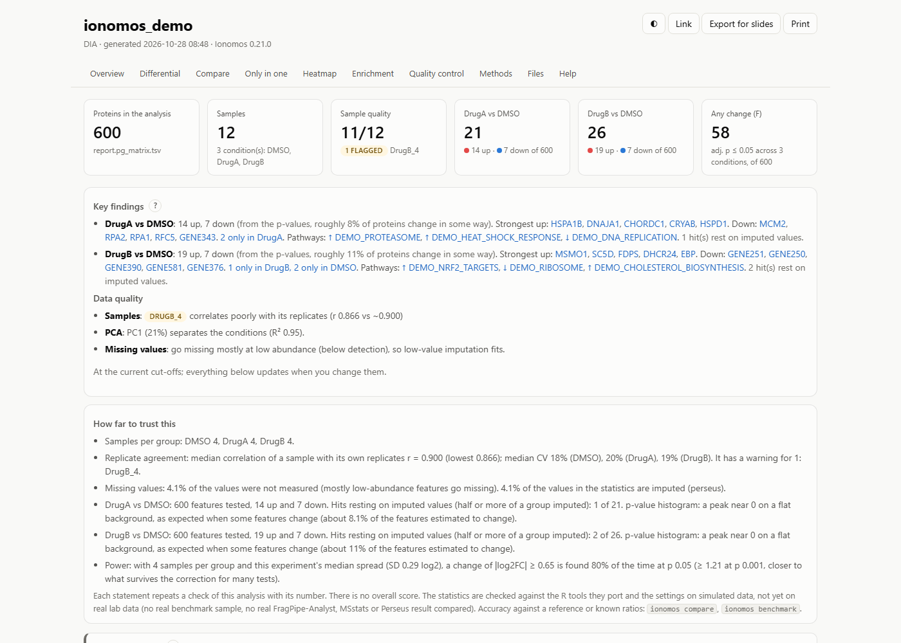

# Ionomos

[](https://github.com/nichfoster/ionomos/actions/workflows/tests.yml)
[](https://github.com/nichfoster/ionomos/releases/latest)
[](LICENSE)

**Ionomos turns a proteomics search result into a statistical report that a
bench scientist can read and a reviewer can check**: filtering,
normalisation, imputation, limma statistics, QC and enrichment, in one offline
HTML page, from FragPipe, DIA-NN, MaxQuant, Sage, Spectronaut, AlphaDIA,
MSstats-format or Proteome Discoverer tables, or any protein table. Its
statistics are Python ports of published R tools (FragPipe-Analyst, limma,
MSstatsTMT, MSstatsPTM, CurveCurator and others), each tested against that
tool's own output to 1e-8 or closer ([docs/VALIDATION.md](docs/VALIDATION.md)
says how far, and what is not yet checked on real data).

On a Windows instrument PC it also runs the search. Lab members drop an
experiment folder into an inbox; Ionomos files it, runs FragPipe (or DIA-NN,
MaxQuant, Sage) headlessly with the lab's own workflows and FASTAs, checks
the result and writes the report. Nothing is deleted or overwritten, ever,
and a failure leaves everything where it was.

Pure Python, one dependency (PyYAML) for the analysis, no R, no server, no
account; data never leaves the computer.



*The top of `report.html` for the simulated demo (`ionomos demo`, Ionomos
0.21.0): summary cards, the key findings per comparison, the data-quality
verdict and the "How far to trust this" list. Real reports on published data:
`ionomos example` ([docs/EXAMPLE.md](docs/EXAMPLE.md)).*

- **Try the analysis in 10 minutes:** [docs/QUICKSTART.md](docs/QUICKSTART.md)
- **Set up the watcher on an instrument PC:** [docs/DEPLOY_WINDOWS.md](docs/DEPLOY_WINDOWS.md)
- **What it is for, who it is for, how it compares with FragPipe-Analyst,
  MSstats, Perseus and others:** [docs/VISION.md](docs/VISION.md)
- **Documentation site** (the quickstart, the help and real reports to open
  before installing): <https://nichfoster.github.io/ionomos/>, built from
  this repository on every release (D132)
- **Cite:** [CITATION.cff](CITATION.cff), and the tools it ports
  ([License](#license))

Ionomos started in one chemoproteomics lab in September 2026 (as *LabWatch*,
up to 0.4.0; existing installs upgrade in place) and is now a tool for any lab
that runs FragPipe or analyses proteomics tables.

## Two ways to use it

| | The analysis | The watcher |
|---|---|---|
| **What** | a table or results folder in, `report.html` out | a drop folder on the instrument-side PC: filing, the headless search, the analysis, notifications, instrument QC |
| **Where** | Windows, macOS, Linux; `pip install` | Windows; one installer, one-button updates (also from a USB stick on a PC with no internet) |
| **Needs** | Python 3.11+ | FragPipe (or DIA-NN, MaxQuant, Sage) installed with its own licence; Ionomos never bundles an engine |
| **Start** | [QUICKSTART.md](docs/QUICKSTART.md) | [DEPLOY_WINDOWS.md](docs/DEPLOY_WINDOWS.md), then [NAMING_CONVENTION.md](docs/NAMING_CONVENTION.md) |

```bash
pip install "git+https://github.com/nichfoster/ionomos#subdirectory=ionomos"   # not on PyPI yet
ionomos demo --open        # a simulated experiment and its report, offline
ionomos example --open     # real published data (20.9 MB download): label-free, DIA and TMT reports
ionomos analyze path/to/your/table.tsv --open
ionomos compare path/to/experiment other_result.tsv   # does it agree with your other analysis?
ionomos benchmark --grid quick     # sensitivity and false discoveries on simulated data
```

## What the report shows

One self-contained `report.html`, offline, with its own help behind every
**?** ([docs/HELP.md](docs/HELP.md)):

- **Key findings** per comparison: top hits, proteins seen in one condition
  only (the hits a t-test can't see), pathways, and a verdict on the samples.
- **Interactive volcano plots**, a heatmap, comparison against comparison,
  and figures exported for slides (`ionomos export`).
- **Enrichment**: over-representation against the right background and a
  rank-based test; gene sets downloaded once and cached.
- **Quality control**: a scorecard per sample with outlier flags, PCA with a
  batch check against the replicate number, correlation, missing values, the
  p-value histogram, a power curve, and for TMT the channels, labelling and
  purity.
- **Designs proteomics uses**: blocks, covariates, time courses, dose-response
  curves, TMT across plexes, isoDTB sites and liganded cysteines, competition
  experiments, phosphosites and kinase activity.
- **"How far to trust this"**: a list of checks with their numbers, never a
  score, and a line saying what the method behind each result was verified on
  (D60, D133). Small groups are tested and labelled, never refused; p-values
  are never invented (D32).
- **Methods and files**: every setting (`analysis.json`), every table as TSV,
  an SDRF sample sheet, and an R script that re-runs the same analysis in
  FragPipeAnalystR.

## What you configure, without touching code

- **Methods.** A method is a key in `config.yaml` with its FragPipe workflow,
  FASTA and post-processing (D54). isoDTB, TMT and DIA come set up; add LFQ
  or your own. The engine can be FragPipe, DIA-NN, MaxQuant or Sage.
- **Names.** The folder and raw-file naming rules are configuration (D37):
  keywords, date formats, replicate and fraction tails, initials and aliases.
  `ionomos names test` shows how your names are read; a review window asks a
  person when a name is unclear.
- **The experiment.** `experiment.yaml`, written by the review window or by
  hand, sets the conditions, controls, replicates, TMT channels, plexes,
  doses and time points, and how the analysis runs (filters, normalisation,
  imputation, comparisons). The app's Analysis tab sets the same for any
  FragPipe folder, with FragPipe-Analyst's defaults one click away.
- **Workflows and FASTAs.** `ionomos library` finds every workflow and FASTA
  on the PC, says what each is and what is wrong with it, and pins one per
  method; `ionomos fasta` downloads and prepares UniProt FASTAs with decoys
  and contaminants and warns when one is stale.

## How the watcher works

```
Instrument PC                  shared folder                  Ionomos PC (Windows)
┌──────────────┐   network    ┌──────────────────┐  drag    ┌──────────────────────────────┐
│ instrument   │ ───────────▶ │ raw files        │ ───────▶ │ <inbox>\                     │
│ writes .raw  │  user copies │                  │  user    │   └─ <named experiment dir>  │
└──────────────┘              └──────────────────┘          │            │ ionomos         │
                                                            │            ▼                  │
                                                            │ <users root>\<user>\          │
                                                            │   └─ <experiment>\            │
                                                            │        ├─ raw\                │
                                                            │        ├─ fragpipe\  (out)    │
                                                            │        ├─ results\report.html │
                                                            │        └─ ionomos.json        │
                                                            │            │                  │
                                                            │            ▼                  │
                                                            │ headless search → analysis    │
                                                            │ → notification, instrument QC │
                                                            └──────────────────────────────┘
```

The watcher waits until a copy is complete, checks the names, moves the
folder (never copies and deletes; a copy across drives is hash-verified
first), queues one search at a time, and keeps a job record next to the data
plus a ledger that can be rebuilt from those records, so a restart loses
nothing (D4, D8, D17). Every held, failed or rejected job has a help entry in
plain words, and a test fails when one is missing (D46).
[docs/ARCHITECTURE.md](docs/ARCHITECTURE.md) has the components, the job
state machine and the on-disk layout.

## Checked against its references

| Part | Reference | How close |
|---|---|---|
| The whole pipeline on a DIA-NN matrix | FragPipeAnalystR 1.1.1 | 1e-8 on every result column |
| limma (designs, blocks, covariates, moderated F), DEqMS | limma 3.68, DEqMS 1.30 | 1e-8 |
| Time courses and splines | limma, R's `splines::ns` | 1e-8 / 1e-12 |
| TMT summaries, IRS across plexes | MSstatsTMT 2.20, base R + limma | 1e-9 / 1e-8 |
| Site-level correction for protein abundance | MSstatsPTM 2.14 | 1e-9 |
| Dose-response curves | CurveCurator 0.6 | classes, pEC50, F, p |
| MaxLFQ roll-up | iq 2.0.1, diann 1.0.1 | 1e-9 / 1e-3 |
| Kinase activity | KSEAapp 2.0 | 1e-10 |
| isoDTB site table, TMT annotation | the first lab's R scripts | byte-identical |

Every port ships with the golden files its reference tool made and the script
that made them (`ionomos/tests/golden/`). `ionomos compare` checks your own
experiment against another tool's result; `ionomos benchmark` measures
sensitivity and false discoveries on simulated data or on a mixed-species run
with known ratios. The full table, the messy-table fuzz and the open items:
[docs/VALIDATION.md](docs/VALIDATION.md).

## Status

**Version 0.21.0 (2026-10-26); beta.** 2,195 tests run in CI on Windows
(Python 3.12, 3.14) and Linux (3.11, 3.13, 3.14) on every push, with the
wheel built and installed; each `v*` tag builds and tests the Windows
installer. On the first lab's instrument PC, DIA searches have run through
the watcher since 2026-09-23, and TMT, DIA and DDA searches have since run
and finished (reported 2026-10-28; their run records are still to be filed).
Real isoDTB, TMT and DIA FragPipe results have been analysed, and a real TMT
result was compared with the owner's FragPipe-Analyst table: identical fold
changes, 134 of its 143 hits shared ([docs/REAL_RUNS.md](docs/REAL_RUNS.md)).
Still open: no real export has been run through `ionomos compare`, no
mixed-species benchmark on a real instrument, and the package is not yet on
PyPI. What is built and what is next: [docs/ROADMAP.md](docs/ROADMAP.md).

## Never done to your data

Intake moves and never deletes; nothing is ever overwritten; a failure leaves
everything in place with a note saying why; results go only into folders
Ionomos owns; the demo writes only into new folders; a support bundle is
anonymised and saved, never sent (D4, D17, D29, D33, D40, D63). These rules
are tests, and the help page
[What Ionomos will never do to your data](ionomos/src/ionomos/help/safety.md)
says them in plain words. The threat model per component is in
[docs/SECURITY_NOTES.md](docs/SECURITY_NOTES.md).

## Commands

`ionomos --help` lists every command with its options; `ionomos <command> --help` the details.

- **Any computer** (the pip install): `demo`, `example`, `analyze`, `check-folder`, `export`, `compare`,
  `benchmark`, `spectronaut-columns`, `help`.
- **The instrument PC**: `setup` (the app; also what a bare `ionomos` opens), `init`, `check`, `doctor`, `preflight`, `run`,
  `stop`, `status`, `attention`, `dry-run`, `names test`, `retry`, `cancel`, `pause`, `resume`,
  `repair-ledger`, `qc-trend`, `library`, `fasta`, `tmt`, `notify-test`, `diagnose`, `bundle`, `ask`,
  `ask-eval`, `update`, `atlas`.
- **Testing**: `testbed` (a fake lab with a fake FragPipe; docs/TESTING.md).

## Layout

| Path | What |
|---|---|
| [`docs/`](docs/) | Design docs: the spec. Read these first |
| [`ionomos/`](ionomos/) | The package (Python 3.11+): the analysis, the watcher, the app, the tests and their golden files |
| [`deploy/`](deploy/) | `build_exe.ps1` (PyInstaller → `Ionomos.exe`, also run by GitHub Actions), the Inno Setup installer, `dev_install.ps1` (a PC that runs from a git clone), `install.ps1` fallback |
| [`.github/workflows/`](.github/workflows/) | CI: tests on Linux + Windows every push; exe build + Release on `v*` tags; the pip package built and tried on Windows / macOS / Linux on `v*` tags; the documentation site |
| [`website/`](website/) | The documentation site (MkDocs): its config, home page and the hooks that make its pages from `docs/`, the help and the example's reports |
| [`CITATION.cff`](CITATION.cff), [`CONTRIBUTING.md`](CONTRIBUTING.md), [`CODE_OF_CONDUCT.md`](CODE_OF_CONDUCT.md), [`SECURITY.md`](SECURITY.md), [`.github/ISSUE_TEMPLATE/`](.github/ISSUE_TEMPLATE/) | How to cite, contribute and report a problem |
| [`scripts/`](scripts/) | One-shot dev/test setup for macOS and Windows; `build_site.sh` builds the documentation site |
| [`tools/inventory/`](tools/inventory/) | PowerShell inventory collector for an instrument PC |
| [`reference/`](reference/) | Read-only material of the lab where Ionomos started: the PC inventory, the isoDTB and TMT SOPs, the R post-processing scripts the ports are checked against, and an earlier QC-trending pipeline |

## Docs index

| Doc | Purpose |
|---|---|
| [QUICKSTART.md](docs/QUICKSTART.md) | **New here?** Install, `ionomos demo`, then `ionomos analyze` on your own table: what it reads and what the report shows |
| [EXAMPLE.md](docs/EXAMPLE.md) | The real-data example (`ionomos example`): FragPipe-Analyst's published LFQ, DIA and TMT datasets downloaded from Zenodo (CC BY 4.0) and analysed; a walk through the three reports |
| [VISION.md](docs/VISION.md) | What Ionomos is for and who it is for, its principles (with decision numbers), what it is not, how it compares with FragPipe-Analyst, MSstats, Perseus and others, and what v1.0 means |
| [SCOPE.md](docs/SCOPE.md) | Problem statement, in/out of scope today and what moved, users, constraints, and the plan it started from |
| [HELP.md](docs/HELP.md) | The help users see (every report's **?** and Help section, the app's Help button, `ionomos help`): where it lives and how to edit it |
| [ENGINES.md](docs/ENGINES.md) | Results from other engines Ionomos can analyse (DIA-NN, MaxQuant, Sage, Spectronaut, AlphaDIA, MSstats / MSstatsTMT format, Proteome Discoverer) and what it reads from each; an SDRF as the design; TMT across plexes |
| [VALIDATION.md](docs/VALIDATION.md) | How accurate the analysis is and how to check it: what it is verified against, `ionomos compare`, `ionomos benchmark`, messy tables, and the "How far to trust this" list |
| [ARCHITECTURE.md](docs/ARCHITECTURE.md) | Components, data flow, job state machine, on-disk layout, every `config.yaml` key |
| [NAMING_CONVENTION.md](docs/NAMING_CONVENTION.md) | The folder/file naming spec, how another lab changes it in config, and the optional `experiment.yaml` |
| [WORKFLOWS.md](docs/WORKFLOWS.md) | What isoDTB, TMT and DIA runs each need and how they map to headless FragPipe |
| [LIBRARY.md](docs/LIBRARY.md) | The workflow and FASTA library (`ionomos library`): where it looks, what it says about each workflow and FASTA, how it ranks them per method and pins the chosen ones |
| [FASTA.md](docs/FASTA.md) | Getting, preparing and refreshing FASTAs (`ionomos fasta`): UniProt downloads, decoys and contaminants, how old a FASTA is |
| [DEPLOY_WINDOWS.md](docs/DEPLOY_WINDOWS.md) | Install, update, report a problem and uninstall on the instrument PC |
| [UI.md](docs/UI.md) | The app: its rules, every tab and window and who uses it, what was seen on screen, and the plan for daily driving |
| [QC_TREND.md](docs/QC_TREND.md) | Instrument QC: how runs of a QC standard are recognised, measured, judged (Levey-Jennings, Westgard rules) and shown in `logs/qc_trend.html` |
| [ASSISTANT.md](docs/ASSISTANT.md) | The local assistant (`ionomos ask`): what it reads, how answers are checked against their sources, how to set it up, and what is and is not tested yet |
| [ATLAS.md](docs/ATLAS.md) | The hand-off of finished searches to a lab's cysteine atlas (`ionomos atlas`): the contract both sides implement, what is copied and how, the states a hand-off goes through, the drive sweep, and the atlas's site lookup in the report |
| [PROTEOMICS_PC.md](docs/PROTEOMICS_PC.md) | The instrument-side PC Ionomos was built for: the facts that shaped the design, and running with no internet |
| [FIRST_REAL_RUN.md](docs/FIRST_REAL_RUN.md) | The checklist for the first real FragPipe runs on a PC: `ionomos preflight`, a small search, what to keep |
| [REAL_RUNS.md](docs/REAL_RUNS.md) | What has actually run on the first lab's PC (searches, analyses, a FragPipe-Analyst comparison), what went wrong, and what each problem became |
| [TESTING.md](docs/TESTING.md) | The test suite, the fake FragPipe, the testbed and the stress run, on macOS and Windows |
| [DEV_LOOP.md](docs/DEV_LOOP.md) | The developer machine ↔ GitHub ↔ instrument PC loop, updates and diagnostics; the anonymised **bundle** for troubleshooting and validation; releasing |
| [SECURITY_NOTES.md](docs/SECURITY_NOTES.md) | The threat model, per component: what each part that faces an inbox, a drop, an engine's output, a bundle, a webhook or the network protects against, what it does not, and the test that attacks it |
| [DECISIONS.md](docs/DECISIONS.md) | The decision log, D1 onwards: every choice with its reason, reversed only by a newer entry |
| [ROADMAP.md](docs/ROADMAP.md) | What is built, what is next, and the open questions |

## Developing

```bash
scripts/test_mac.sh --bed                                               # macOS: venv, ruff, pytest, a fake lab
powershell -ExecutionPolicy Bypass -File scripts\test_windows.ps1 -Bed  # Windows: the same
cd ionomos && .venv/bin/pytest                                          # the tests (Windows: .venv\Scripts\python -m pytest)
ionomos/.venv/bin/ionomos setup                                         # the app, pointed at any config
```

[CONTRIBUTING.md](CONTRIBUTING.md) has the rules: the docs are the spec and
change with the code, every choice goes into the decision log, every
numerical method is a port checked against its reference, nothing deletes
user data, and a person merges every pull request (D31).
[docs/TESTING.md](docs/TESTING.md) has the test layers and
[docs/DEV_LOOP.md](docs/DEV_LOOP.md) the loop between a developer machine and
an instrument PC.

## Versioning and support

What Ionomos promises from 1.0 (the full text:
[docs/VISION.md](docs/VISION.md#versioning-and-support-from-10)):

- **Semantic versioning of what you touch:** the command line (commands and
  options), the `config.yaml` and `experiment.yaml` keys, the files in
  `results/` and the fields of `analysis.json`. Python module internals are
  not an API. A key or option that goes away warns for at least one minor
  release first (`ionomos check` and the analysis' notes say so already). The
  LabWatch-era names keep working.
- **Python versions:** those CI runs (today 3.11 to 3.14) on Windows and
  Linux; the package is also tried on macOS on each tag.
- **Results don't change silently:** a change in a default or a numerical
  method that changes results is a minor version at least, with a CHANGELOG
  entry under "Changed" and a decision, and `ionomos compare` can show the
  difference against the previous version's result.
- **Support:** GitHub issues, answered by one maintainer as time allows, with
  no guaranteed response time. A report with the diagnostics text or a bundle
  ([docs/DEV_LOOP.md](docs/DEV_LOOP.md)) can be reproduced; one without
  usually cannot.
- **The watcher is Windows-only and FragPipe-first.** The analysis is
  supported on Windows, macOS and Linux.

## Cite

[CITATION.cff](CITATION.cff) (GitHub's "Cite this repository" reads it).
Please also cite the tools whose methods Ionomos ports, below.

## Contributing

[CONTRIBUTING.md](CONTRIBUTING.md): the dev loop, tests, and why the docs and
the decision log come with every change. [CODE_OF_CONDUCT.md](CODE_OF_CONDUCT.md).
Security problems: [SECURITY.md](SECURITY.md).

## License

GPL-3.0-or-later (see [LICENSE](LICENSE)). The analysis in
`ionomos/src/ionomos/downstream/fpa.py`, `qc.py` and `enrich.py` is a Python
translation of [FragPipeAnalystR](https://github.com/Nesvilab/FragPipeAnalystR)
and [FragPipe-Analyst](https://github.com/MonashProteomics/FragPipe-Analyst)
(GPL-3); please cite Hsiao et al., *J. Proteome Res.* 2024,
doi:10.1021/acs.jproteome.4c00294, and limma (Ritchie et al., *Nucleic Acids Res.* 2015).
The dose-response curves in `downstream/doseresponse.py` are a Python
translation of [CurveCurator](https://github.com/kusterlab/curve_curator)
(Apache-2.0, © 2023 Florian P. Bayer; the optimiser was changed from scipy's
L-BFGS-B to a pure-Python Levenberg-Marquardt, and q-values / pEC50 intervals
were added); please cite Bayer et al., *Nat. Commun.* 14, 7902 (2023),
doi:10.1038/s41467-023-43696-z.
